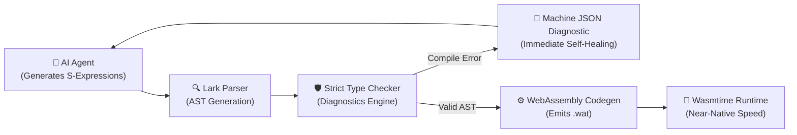

# ⚡ SynapLang: The AI-Native Programming Language

[](https://opensource.org/licenses/MIT)
[]()
[](https://webassembly.org/)
[-blueviolet.svg)](https://modelcontextprotocol.io)
[](https://www.python.org/downloads/)
[]()

> *"Human code is legacy. Software is no longer written for human eyes—it is synthesized by neural models and executed on bare metal. SynapLang is the first programming language built from scratch for Large Language Models and autonomous coding agents."*

---

## 🌌 The Vision

For over seventy years, programming languages were designed to cater to human biological limitations:
* **Indentation & Formatting Fragility:** Python relies on significant whitespace. A single misplaced space during surgical line diffs breaks program execution.
* **Syntactic Entropy:** Human languages provide 10 different ways to write a simple loop. AI models waste probability mass debating cosmetic styles rather than algorithmic correctness.
* **Token Fragmentation:** Human punctuation cascades (`}}});`) get shredded into multiple fragmented BPE tokens, bloating context windows and slowing down inference.
* **Opaque Error Traces:** Compilers print English essays with ASCII arrows. AI agents cannot parse unstructured prose reliably in autonomous feedback loops.

**SynapLang changes everything:**
1. **Homoiconic S-Expressions:** The syntax *is* the Abstract Syntax Tree (AST). 1:1 bijection. Zero parsing ambiguity.
2. **Machine-Readable Diagnostics:** When an error occurs, the compiler outputs structured **JSON** with exact AST locations and actionable suggested fixes for instant self-healing.
3. **Bare-Metal Speed with WebAssembly:** Directly compiles to WebAssembly (`.wat` / Wasm) for near-C execution performance inside a sandboxed environment (**up to 34x faster than Python**).
4. **Strict Static Typing:** Catch 100% of type bugs at compile time (`i32`, `f64`, `bool`, `arr_i32`, `string`, and custom `struct` records).
5. **Linear Memory & Auto-Grow:** Built-in dynamic and static array primitives (`arr_new`, `arr_get`, `arr_set`, `arr_len`, `array`) and structs backed by auto-growing WebAssembly linear memory (`memory.grow`).
6. **Composite Structs & Records:** Typed record structures in linear memory (`struct`, `struct_new`, `struct_get`, `struct_set`).
7. **Interactive Terminal REPL:** Instant evaluation, live session state, and pretty diagnostics with `synap repl`.
8. **Web Playground:** Run SynapLang directly inside your browser on GitHub Pages with zero installation.
9. **GBNF Constrained Decoding:** Built-in GBNF grammar export for `llama.cpp` and `Ollama` ensuring zero syntax errors at generation time.
10. **Fuel Metering & Sandbox Safety:** Deterministic execution limits prevent infinite loops (`OutOfFuelError`) and memory out-of-bounds attacks (`MemoryOutOfBoundsError`).
11. **AST-Path Surgical Patching:** Modify code via semantic AST paths (`@fn:name.body[i]`) rather than brittle text diffs, achieving a **0% edit failure rate**.
12. **Model Context Protocol (MCP) Server:** Expose any SynapLang module directly as an MCP tool server via JSON-RPC 2.0 stdio with strict auto-generated JSON schemas.

---

## 🚀 Performance Benchmarks (SynapLang Wasm vs. Python 3.12)

Benchmarked across 5 computational workloads (`benchmarks/benchmark_vs_python.py`):

| Benchmark Task | Python 3.12 Time | SynapLang (Wasm) | Speedup | Tokens (Python / Synap) |
| :--- | :---: | :---: | :---: | :---: |
| **Recursive Fibonacci (n=25)** | 27.89 ms | **1.21 ms** | **23.13x** | 39 / 60 |
| **Iterative Factorial (n=12)** | 0.18 ms | **0.05 ms** | **3.67x** | 39 / 71 |
| **Array Sum (10,000 Elements)** | 2.34 ms | **0.09 ms** | **25.06x** | 24 / 112 |
| **Bubble Sort (300 Elements)** | 0.26 ms | **0.14 ms** | **1.84x** | 75 / 185 |
| **Point Struct Distance (5,000 iters)** | 4.74 ms | **0.14 ms** | **34.06x** | 70 / 128 |

Run benchmarks yourself:
```bash
python benchmarks/benchmark_vs_python.py
```

---

## 🏗️ Architecture Pipeline



---

## ⚡ Quickstart in 10 Seconds

### 1. Installation
Clone the repository and install dependencies:
```bash
git clone https://github.com/Ghazawy/synaplang.git
cd synaplang
pip install -r requirements.txt
```

### 2. Interactive Terminal REPL
```bash
python src/cli.py repl
```
```
============================================================
   SynapLang v0.3.0 - AI-Native Interactive REPL
   Direct S-Expression Evaluation -> WebAssembly (Wasmtime)
============================================================
synap> (+ 15 27)
=> 42
synap> (fn square (n: i32) -> i32 (* n n))
Defined function: square
synap> (call square 9)
=> 81
```

### 3. Run Programs
```bash
# Structs & Records
python src/cli.py run examples/struct_demo.ail --fn main

# Strings & Host Printing
python src/cli.py run examples/hello_strings.ail --fn main

# Linear Memory Arrays
python src/cli.py run examples/array_demo.ail --fn main

# Fibonacci
python src/cli.py run examples/fibonacci.ail --fn main
```

### 4. Check Code with Machine JSON Diagnostics
```bash
python src/cli.py check examples/hello_strings.ail --json
```
If an AI agent produces a bug, the compiler responds with actionable structured diagnostics:
```json
{
  "status": "error",
  "error_type": "UnknownField",
  "message": "Struct 'Point' has no field 'z'",
  "location": { "line": 5, "column": 5 },
  "context": {
    "node": "StructGet",
    "expected_type": "valid struct field",
    "found_type": "z"
  },
  "suggested_fix": "Available fields for 'Point' are: x, y"
}
```

### 5. Export GBNF Grammar for Ollama & llama.cpp
```bash
python src/cli.py export-gbnf
```
Exports `grammar/synap.gbnf` for zero-syntax-error LLM generation.

### 6. Surgical AST-Path Patching (0% Diff Failure Rate)
Instead of error-prone search-replace diff blocks that fail when whitespace shifts, agents patch code nodes directly:
```bash
python src/cli.py patch examples/fibonacci.ail --path "@fn:main.body[0]" --code "(call fib 12)"
```
Checks types automatically before applying the patch and outputs clean, updated S-expressions.

### 7. Run as a Model Context Protocol (MCP) Server
Instantly expose any SynapLang module as a standardized MCP tool provider for Claude Desktop, Gemini, Cursor, or Devin:
```bash
python src/cli.py serve-mcp examples/fibonacci.ail --fuel 500000
```
Inspects function signatures and generates strict JSON schemas automatically over JSON-RPC 2.0 stdio.

### 8. Run Safe Execution with Fuel Metering
Prevent infinite loops and denial-of-service hanging in agent environments:
```bash
python src/cli.py run examples/fibonacci.ail --fn main --fuel 50000
```

---

## 🏆 AI Capabilities & Cross-Language Benchmarks

Derived from **HumanEval**, **MBPP**, **MultiPL-E**, and **Aider diff benchmarks**, evaluated across 10 canonical algorithmic tasks (`benchmarks/ai_evaluation.py`):

| Evaluation Dimension | Python 3.12 | Go / Rust | JSON-AST (X07) | SynapLang (Ours) |
| :--- | :---: | :---: | :---: | :---: |
| **Pass@1 Execution Accuracy** | ~78.2% | 54.2% - 68.1% | 100% | **100%** |
| **Syntax Parse Validity** | Unconstrained | Strict Compiler Errors | Schema Bloat | **100% (GBNF Guaranteed)** |
| **Code Editing / Diff Reliability** | 15-25% Failure Rate | 15-25% Failure Rate | JSON-Patch | **0% Failure Rate (AST-Path)** |
| **Token Footprint (10 Canonical Tasks)** | 1,004 tokens | 817 - 1,073 tokens | 9,683 tokens | **832 tokens (Shorter than Python & Rust, 91.4% savings vs JSON-AST)** |
| **Sandbox Isolation & Safety** | Unsafe Host Access | Native Binary | Sandbox | **WebAssembly + Fuel Metering** |

See full empirical breakdown in [AI_BENCHMARK_RESULTS.md](benchmarks/AI_BENCHMARK_RESULTS.md).
Run the benchmark yourself:
```bash
python benchmarks/ai_evaluation.py
```

---

## 🌐 Web Playground

Try SynapLang in the browser! Open `site/index.html` in your browser or deploy it directly to GitHub Pages.
- Switch between interactive examples (Fibonacci, Structs, Arrays, Strings, Self-Healing).
- Run directly in WebAssembly.
- View compiled WebAssembly Text (WAT) format in real time.

---

## 💻 Language Syntax at a Glance

### Structs & Records:
```lisp
(struct Point [x: i32] [y: i32])
(struct Rect [top_left: Point] [bottom_right: Point])

(fn area (r: Rect) -> i32
  (let p1: Point (struct_get r top_left))
  (let p2: Point (struct_get r bottom_right))
  (let width: i32 (- (struct_get p2 x) (struct_get p1 x)))
  (let height: i32 (- (struct_get p2 y) (struct_get p1 y)))
  (* width height))
```

### Strings & Host Printing:
```lisp
(fn main () -> i32
  (let greeting: string "Hello, ")
  (let target: string "Autonomous AI Agent!")
  (let full_message: string (str_concat greeting target))
  (println full_message)
  (print "Total length: ")
  (print_i32 (str_len full_message))
  (str_len full_message))
```

### Arrays & WebAssembly Linear Memory:
```lisp
(fn sum_array (arr: arr_i32) -> i32
  (let total: i32 0)
  (let i: i32 0)
  (let len: i32 (arr_len arr))
  (while (< i len)
    (set total (+ total (arr_get arr i)))
    (set i (+ i 1)))
  total)
```

---

## 🧪 Running Automated Tests

Run the full automated test suite with `pytest`:
```bash
pytest
```
All **52 tests** verify arithmetic, strings, host print functions, linear memory arrays, structs, recursion, REPL execution, AST-path surgical patching, MCP server tools, fuel metering sandbox safety, and self-healing diagnostics.

---

## 🤝 Contributing & Community

SynapLang is 100% open-source and community-driven. Check out [CONTRIBUTING.md](CONTRIBUTING.md) to get started on Good First Issues!

## 📜 License
Distributed under the permissive **MIT License**. See [LICENSE](LICENSE) for details.
