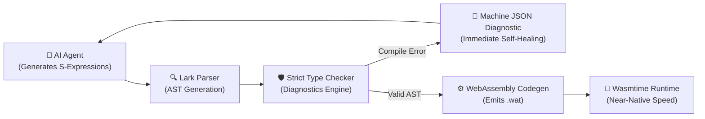

# ⚡ SynapLang: The AI-Native Programming Language

[](https://opensource.org/licenses/MIT)
[]()
[](https://webassembly.org/)
[](https://www.python.org/downloads/)

> *"Human code is legacy. Software is no longer written for human eyes—it is synthesized by neural models and executed on bare metal. SynapLang is the first programming language built from scratch for Large Language Models and autonomous coding agents."*

---

## 🌌 The Vision

For over seventy years, programming languages were designed to cater to human biological limitations:
* **Indentation & Formatting Fragility:** Python relies on significant whitespace. A single misplaced space during surgical line diffs breaks program execution.
* **Syntactic Entropy:** Human languages provide 10 different ways to write a simple loop. AI models waste probability mass debating cosmetic styles rather than algorithmic correctness.
* **Token Fragmentation:** Human punctuation cascades (`}}});`) get shredded into multiple fragmented BPE tokens, bloating context windows and slowing down inference.
* **Opaque Error Traces:** Compilers print English essays with ASCII arrows. AI agents cannot parse unstructured prose reliably in autonomous feedback loops.

**SynapLang changes everything:**
1. **Homoiconic S-Expressions:** The syntax *is* the Abstract Syntax Tree (AST). 1:1 bijection. Zero parsing ambiguity.
2. **Machine-Readable Diagnostics:** When an error occurs, the compiler outputs structured **JSON** with exact AST locations and actionable suggested fixes for instant self-healing.
3. **Bare-Metal Speed with WebAssembly:** Directly compiles to WebAssembly (`.wat` / Wasm) for near-C execution performance inside a sandboxed environment.
4. **Strict Static Typing:** Catch 100% of type bugs at compile time (`i32`, `f64`, `bool`, `arr_i32`, `string`).
5. **Linear Memory & Arrays:** Built-in dynamic and static array primitives (`arr_new`, `arr_get`, `arr_set`, `arr_len`, `array`) managed in WebAssembly linear memory.
6. **Strings & Host Printing:** Built-in string literals, dynamic concatenation (`str_concat`), and zero-overhead host I/O (`print`, `println`, `print_i32`, `print_f64`).
7. **GBNF Constrained Decoding:** Built-in GBNF grammar export for `llama.cpp` and `Ollama` ensuring zero syntax errors at generation time.

---

## 🏗️ Architecture Pipeline



---

## 🥊 Human Languages vs. SynapLang

| Dimension | Legacy Human Languages (Python / JS / C++) | SynapLang (AI-Native Language) |
| :--- | :--- | :--- |
| **Primary Consumer** | Human eyes & short-term memory | LLMs & Autonomous AI Agents |
| **Parsing Precedence** | Complex operator precedence tables | Unambiguous Tree / S-expressions |
| **Whitespace Impact** | Significant indentation errors | Whitespace invariant |
| **Compiler Feedback** | Human prose & ASCII error strings | **Structured JSON diagnostics with auto-fix hints** |
| **Execution Model** | Slow dynamic runtime or heavy toolchains | **Blazing-fast sandboxed WebAssembly (Wasm)** |
| **Memory & Data** | Garbage collectors or manual pointers | **Safe Linear Memory arrays (`arr_i32`) & strings** |
| **I/O Integration** | Heavy system libraries | **Direct Host Function Calls (`print`, `println`)** |
| **Context Window Cost**| Heavy boilerplate & token fragmentation | Minimal token overhead, maximum semantic density |

---

## ⚡ Quickstart in 10 Seconds

### 1. Installation
Clone the repository and install dependencies:
```bash
git clone https://github.com/Ghazawy/synaplang.git
cd synaplang
pip install -r requirements.txt
```

### 2. Run Examples
```bash
# Strings & Host Printing
python src/cli.py run examples/hello_strings.ail --fn main
# Output:
# Hello, Autonomous AI Agent!
# Total message length: 27

# WebAssembly Linear Memory Arrays
python src/cli.py run examples/array_demo.ail --fn main
# Output: 220

# Fibonacci Algorithm
python src/cli.py run examples/fibonacci.ail --fn main
# Output: 55
```

### 3. Check Code with Machine JSON Diagnostics
```bash
python src/cli.py check examples/hello_strings.ail --json
```
Output:
```json
{
  "status": "ok",
  "message": "Type check passed successfully"
}
```

If you introduce a type error, the compiler outputs actionable structured data:
```json
{
  "status": "error",
  "error_type": "TypeMismatch",
  "message": "println expects string argument, got 'i32'",
  "location": {
    "line": 3,
    "column": 12
  },
  "context": {
    "node": "PrintlnStr",
    "expected_type": "string",
    "found_type": "i32"
  },
  "suggested_fix": "Pass a string expression to (println ...)"
}
```

### 4. Export GBNF Grammar for Ollama & llama.cpp
```bash
python src/cli.py export-gbnf
```
Exports `grammar/synap.gbnf` for grammar-constrained sampling.

---

## 💻 Language Syntax at a Glance

### Strings & Host Printing:
```lisp
(fn main () -> i32
  (let greeting: string "Hello, ")
  (let target: string "Autonomous AI Agent!")
  (let full_message: string (str_concat greeting target))
  (println full_message)
  (print "Total length: ")
  (print_i32 (str_len full_message))
  (str_len full_message))
```

### Arrays & WebAssembly Linear Memory:
```lisp
(fn sum_array (arr: arr_i32) -> i32
  (let total: i32 0)
  (let i: i32 0)
  (let len: i32 (arr_len arr))
  (while (< i len)
    (set total (+ total (arr_get arr i)))
    (set i (+ i 1)))
  total)

(fn main () -> i32
  (let numbers: arr_i32 (array 10 20 30 40 50))
  (arr_set numbers 2 100)
  (call sum_array numbers))
```

### Recursive Fibonacci:
```lisp
(fn fib (n: i32) -> i32
  (if (<= n 1)
    n
    (+ (call fib (- n 1))
       (call fib (- n 2)))))

(fn main () -> i32
  (call fib 10))
```

---

## 🧪 Running Automated Tests

Run the full automated test suite with `pytest`:
```bash
pytest
```
All **31 tests** verify arithmetic, strings, host print functions, linear memory arrays, nested precedence, control flow, recursion, type checking, and automated agent self-healing loops.

---

## 🤝 Contributing & Community

SynapLang is 100% open-source and community-driven. Check out [CONTRIBUTING.md](CONTRIBUTING.md) to get started on Good First Issues!

## 📜 License
Distributed under the permissive **MIT License**. See [LICENSE](LICENSE) for details.
