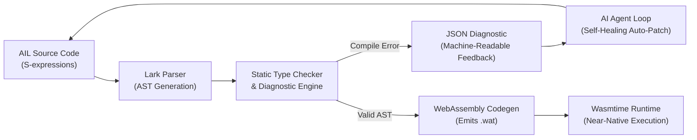

# Technical Architecture & Language Specification

## 1. System Pipeline Architecture

The language toolchain consists of a five-stage deterministic compiler and execution engine:



---

## 2. Formal Grammar Specification

The language adopts a strict, homoiconic S-expression grammar:

### 2.1 Types
* `i32`: 32-bit signed integer.
* `f64`: 64-bit IEEE 754 floating-point number.
* `bool`: Boolean value (`true` or `false`, represented as 0 or 1 in Wasm).

### 2.2 Core Language Forms
```lisp
;; 1. Program Structure
(module <definition>*)

;; 2. Function Definition
(fn <name> (<param_name>: <type>)* -> <return_type>
  <expression>+)

;; 3. Variable Binding & Mutation
(let <name>: <type> <initial_value>)
(set <name> <new_value>)

;; 4. Arithmetic & Logical Operations
(+ <expr> <expr>)
(- <expr> <expr>)
(* <expr> <expr>)
(/ <expr> <expr>)
(% <expr> <expr>)

(== <expr> <expr>)
(!= <expr> <expr>)
(<  <expr> <expr>)
(<= <expr> <expr>)
(>  <expr> <expr>)
(>= <expr> <expr>)

(and <expr> <expr>)
(or  <expr> <expr>)
(not <expr>)

;; 5. Control Flow
(if <condition> <then_expr> <else_expr>)
(while <condition> <body_expr>+)

;; 6. Function Invocations & Returns
(call <fn_name> <arg_expr>*)
(return <expr>)
```

---

## 3. Machine-Readable Diagnostic Format (JSON Schema)

When the compiler encounters any syntax, type, or semantic anomaly, it suppresses human prose and emits a structured JSON payload over stderr:

```json
{
  "status": "error",
  "error_type": "TypeMismatch",
  "message": "Expected i32 but received f64 in binary operator",
  "location": {
    "line": 4,
    "column": 12
  },
  "context": {
    "node": "binary_op",
    "operator": "+",
    "expected_type": "i32",
    "found_type": "f64"
  },
  "suggested_fix": {
    "action": "cast_or_replace",
    "recommendation": "Ensure both operands evaluate to matching types: i32 or f64"
  }
}
```

This diagnostic format enables autonomous agents to immediately identify the failing AST node and generate targeted repair patches in a single inference step.

---

## 4. WebAssembly (Wasm) Emission Mapping

Every high-level S-expression maps directly to an equivalent WebAssembly Text (`WAT`) construct:

| AIL Construct | WebAssembly Text Representation |
| :--- | :--- |
| `(fn add (a: i32 b: i32) -> i32 ...)` | `(func $add (param $a i32) (param $b i32) (result i32) ...)` |
| `(+ a b)` | `(i32.add (local.get $a) (local.get $b))` |
| `(if cond then else)` | `(if (result <type>) <cond> (then <then>) (else <else>))` |
| `(while cond body)` | `(block (loop (br_if 1 (i32.eqz <cond>)) <body> (br 0)))` |
| `(call func arg)` | `(call $func <arg>)` |
